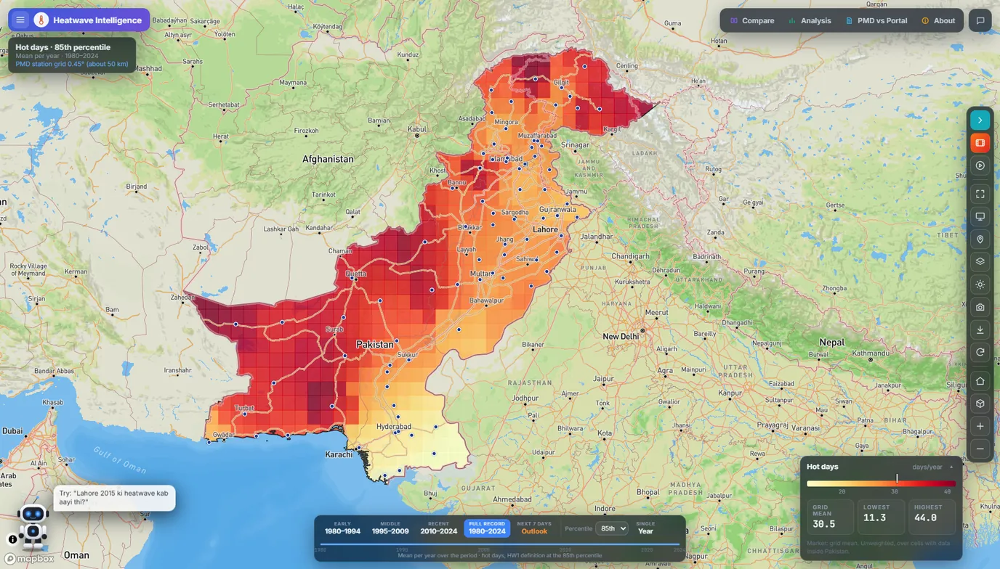
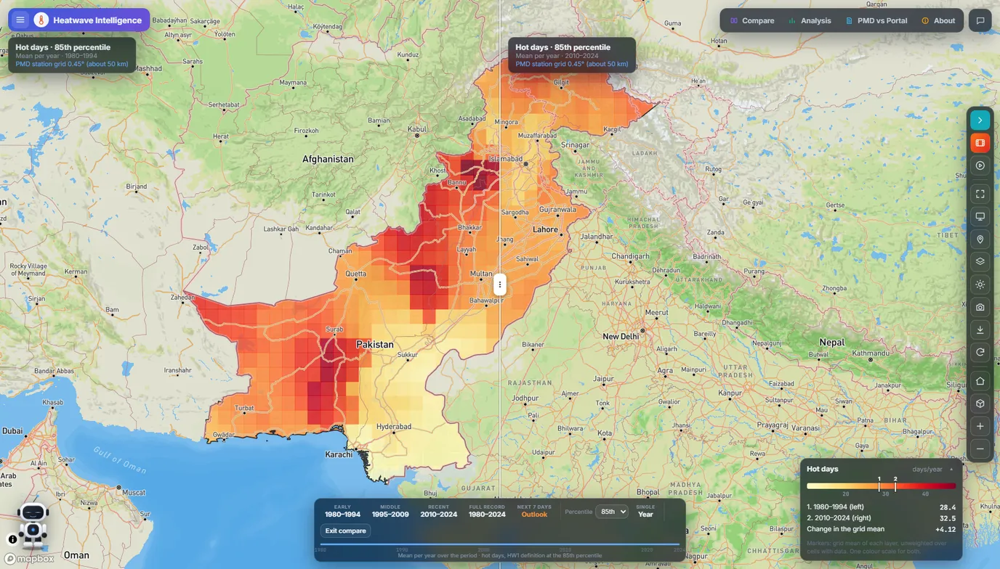
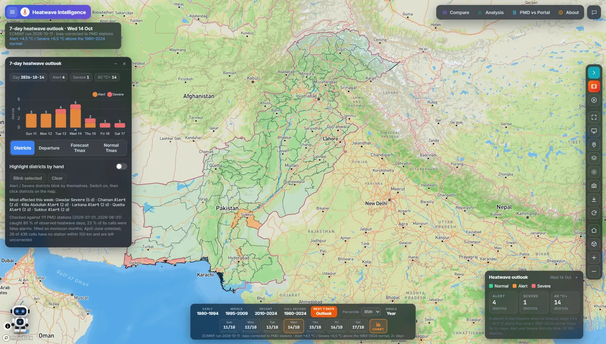
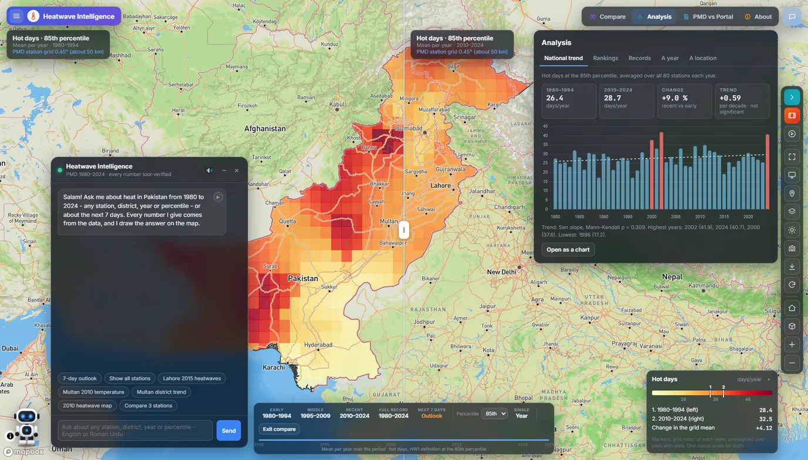
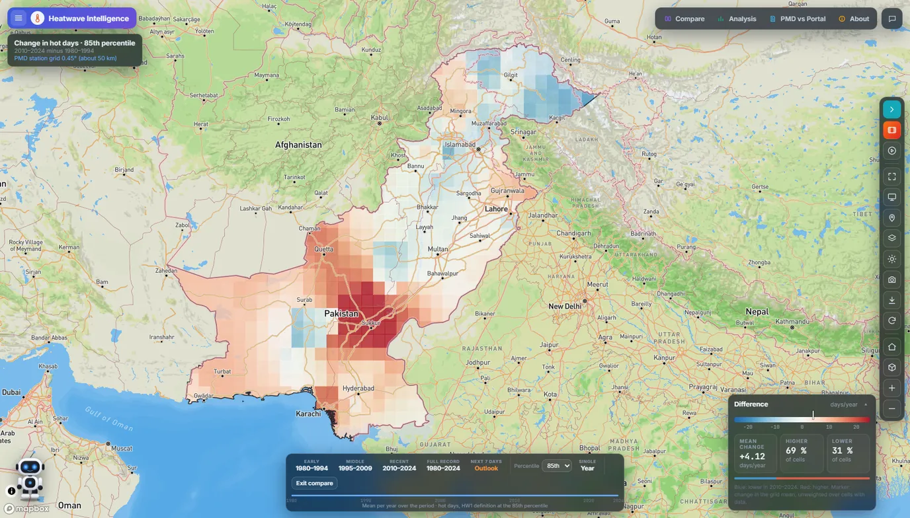
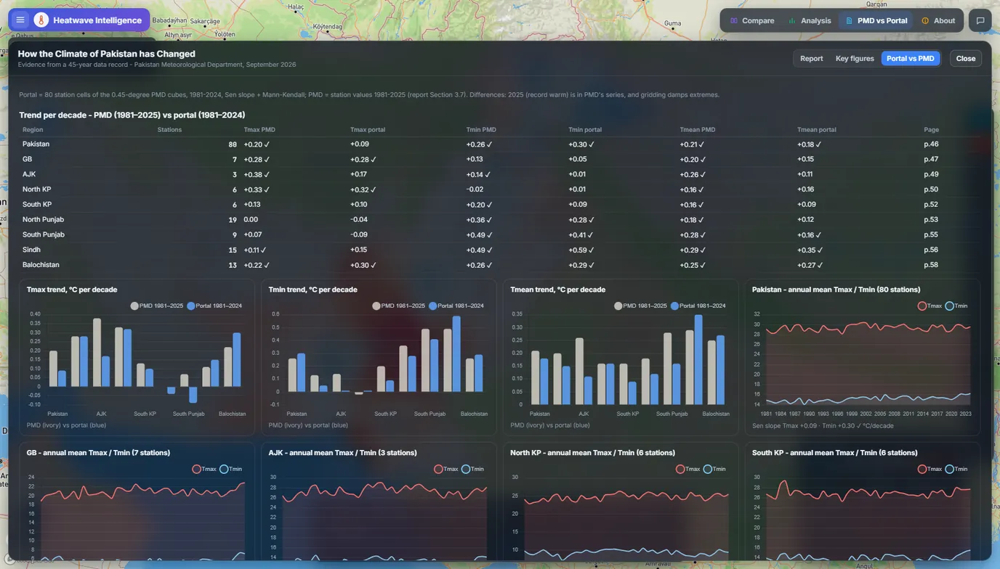
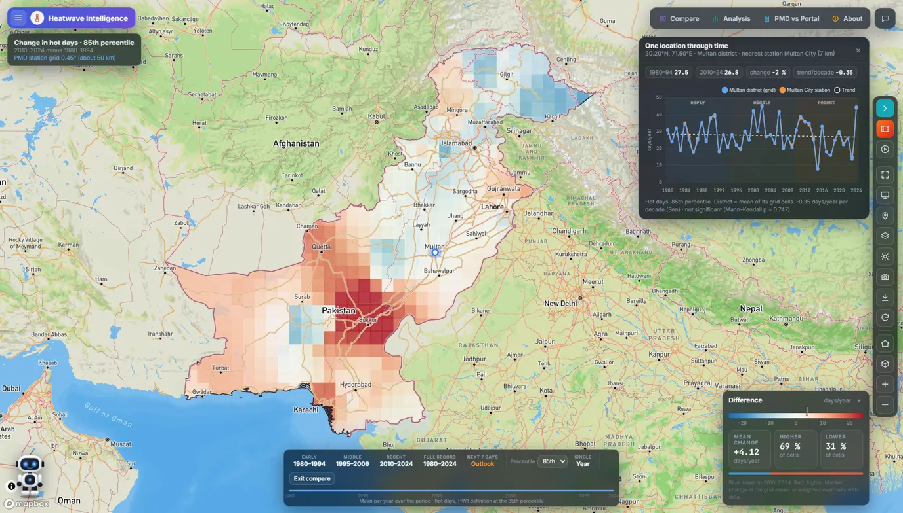
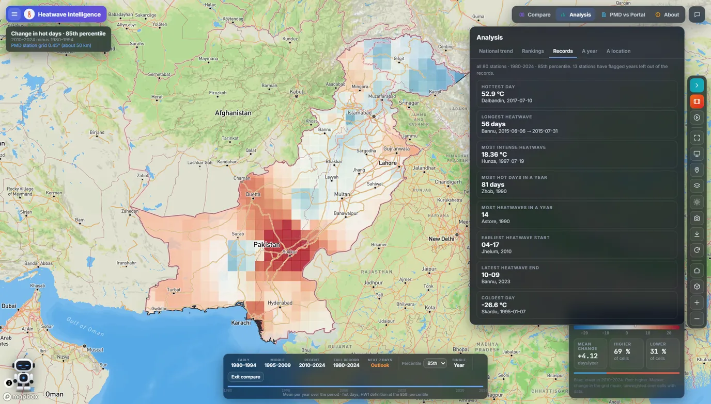

# Heatwave Intelligence

A web portal for NDMA Pakistan that shows how heat in Pakistan has changed since 1980, and which districts face a heatwave in the next seven days.

**Demo video:** [watch on LinkedIn](https://lnkd.in/p/dy69fhmt)

## What it does

- **45 years of station data on one map**: PMD records from 1980 to 2024 on a 0.45° grid (about 50 km), with five heatwave measures at four percentile thresholds.
- **Compare periods and years**: a swipe, side-by-side or difference view between any two periods or years.
- **Trends, rankings and records**: a Mann-Kendall trend test with Sen's slope, national and station rankings, all-time records, and a chart for any place.
- **7-day heatwave outlook**: the ECMWF forecast, bias-corrected to 111 PMD stations, with districts flagged Alert or Severe.
- **A chat assistant that answers with data**: questions in English or Roman Urdu; every number it gives comes from a data tool, and it draws its answer on the map.

**Checked against the record:** tested on July and August 2026 against 111 PMD stations, the outlook caught 80% of observed heatwave days, and 23% of its calls were false alarms.

| | |
|---|---|
|  |  |
| Swipe compare: 1980-1994 against 2010-2024 | The 7-day outlook, with Alert and Severe districts |
|  |  |
| The chat assistant beside the national trend analysis | Where hot days rose or fell: 2010-2024 minus 1980-1994 |
|  |  |
| Checked against PMD: trends per decade, PMD's report against the portal, by region | Any place through time, with its nearest station and a Mann-Kendall trend |
|  | |
| National records from 80 stations, 1980-2024 | |

## Built with

Mapbox GL JS, JavaScript, FastAPI, Python

## Data

Pakistan Meteorological Department (PMD) station records, ECMWF forecasts

## Code and data access

The source code is private and belongs to NDMA Pakistan. To ask about the code or the data,
email **ranahasnain061@gmail.com**, [open an issue](../../issues) in this repository, or message me on
[LinkedIn](https://www.linkedin.com/in/muhammad-hasnain-87450033a/).

---
Built by [Muhammad Hasnain](https://hasnain061-ai.github.io) at NDMA Pakistan.
